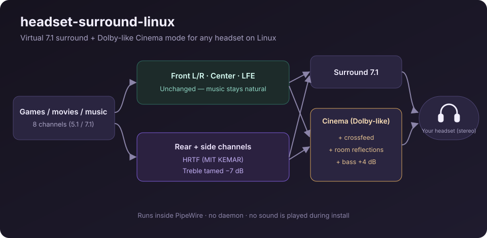

# headset-surround-linux

**English** · [Türkçe](README.tr.md)

Virtual 7.1 surround and a Dolby-like **Cinema** mode for any headset on Linux, set up with one command.
It runs inside PipeWire, so there is no extra app or daemon. It was made for the Logitech G633, but it works
with any USB, Bluetooth or analog headset.



## Install

```bash
curl -fsSL https://raw.githubusercontent.com/gok8lp/headset-surround-linux/main/install.sh | bash
```

Run without options, the installer shows a short menu and asks which output is your headset.
To pick the parts yourself, pass options:

```bash
curl -fsSL https://raw.githubusercontent.com/gok8lp/headset-surround-linux/main/install.sh | bash -s -- --all
```

You get three new outputs in your sound settings:

| Output | What it does |
|---|---|
| **Surround 7.1** | Front, center and LFE pass through unchanged, so music sounds exactly as before. Rear and side channels are placed behind and beside you with an HRTF (MIT KEMAR), and the HRTF's harsh treble is tamed. |
| **Bass Boost** | Surround plus heavy bass: +10 dB low shelf at 90 Hz and +5 dB sub-bass at 45 Hz, with a small cut in the muddy mids and a bit of air on top. The signal is first lowered by 9 dB so the boost does not clip. |
| **Cinema (Dolby-like)** | Surround plus crossfeed (speaker-like front image), early room reflections, +4 dB bass and a little presence. It is close in spirit to the "Dolby / DTS Headphone" mode in vendor apps. |

> **Safe by design:** the installer never plays a sound. New outputs start at **30 %** volume, and the real
> headset device is set to 100 % so all loudness control is on the virtual output.

## Options

| Option | |
|---|---|
| `--surround` | Surround, Cinema and Bass Boost outputs |
| `--headsetcontrol` | Install [HeadsetControl](https://github.com/Sapd/HeadsetControl) (sidetone, LEDs, battery, auto-off) |
| `--dark` | Dark-mode fix: GTK `prefer-dark`, `adw-gtk3-dark` theme, and Flatpak Qt apps that start light |
| `--hyprland` | Hyprland volume keys: 2 % step, 150 % max (`--vol-step`, `--vol-max`) |
| `--all` | Everything above |
| `--device SINK` | Choose the output device (`--list-devices` lists them) |
| `--no-default` | Do not make Surround the default output |
| `--uninstall` | Remove the outputs and restore your headset as default |
| `--dry-run` | Show what would change, change nothing |
| `-y` | No questions |
| `--lang tr` | Turkish messages |

## Uninstall

```bash
curl -fsSL https://raw.githubusercontent.com/gok8lp/headset-surround-linux/main/install.sh | bash -s -- --uninstall
```

Every file the installer replaces is backed up first to `~/.local/share/headset-surround/backup/`.

## Platforms

| | |
|---|---|
| Arch, EndeavourOS, Manjaro, CachyOS | ✅ tested (Arch-based: real install; others: dry run in containers) |
| Ubuntu / Debian / Mint / Pop!_OS, Fedora, openSUSE, Void, Alpine… | ✅ any distro running **PipeWire** with `pipewire-pulse` |
| Any desktop: GNOME, KDE, Hyprland, Sway… | ✅ systemd user service, or XDG autostart without systemd |
| Windows / macOS | ❌ no PipeWire there; use your vendor app (e.g. Logitech G HUB) |

Notes:
- If your PipeWire build has no SOFA plugin (older Ubuntu/Debian), the installer automatically uses a simpler
  time/level-difference virtualizer instead of the HRTF.
- `headsetcontrol` is in the Arch and Fedora repos. Elsewhere the installer prints the source link.
- If the MIT KEMAR HRTF is not already on the system, it is downloaded once from the
  [libmysofa](https://github.com/hoene/libmysofa) repository.

## How it works

The installer writes three PipeWire
[filter-chain](https://docs.pipewire.org/page_module_filter_chain.html) configs to
`~/.config/pipewire/filter-chain.conf.d/` and runs them with the `filter-chain` user service (or its own
`headset-surround.service` if your distro does not ship one). Each config creates an 8-channel virtual sink
whose stereo output is pinned to your headset.

## Troubleshooting

- **It sounds too quiet:** raise the *Surround/Cinema* output volume, not the headset's. `--hyprland` lets the
  volume keys go up to 150 %.
- **Nothing appears:** run `journalctl --user -u filter-chain`, then rerun the installer with `--dry-run`.
- **Some apps still start light:** restart them after `--dark`. Flatpak GTK3 apps may also need
  `flatpak install org.gtk.Gtk3theme.adw-gtk3-dark`.

## License

[MIT](LICENSE). Dolby is a trademark of Dolby Laboratories. This project is not affiliated with Dolby or
Logitech, and "Cinema" only imitates that kind of sound.
