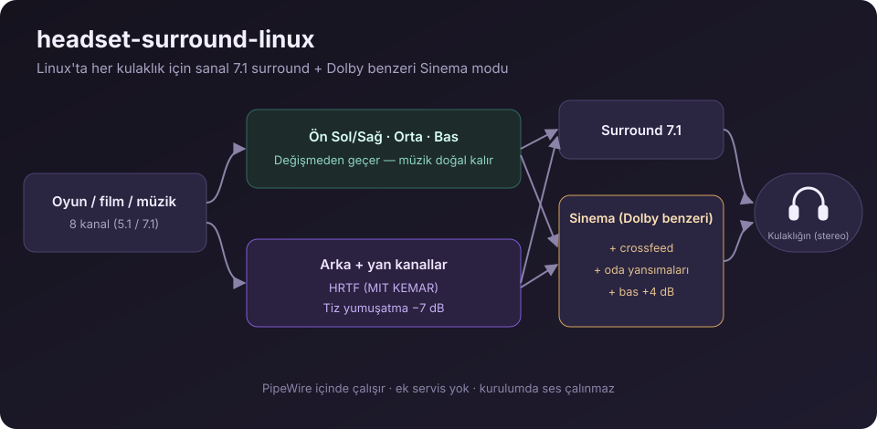

# headset-surround-linux

[English](README.md) · **Türkçe**

Linux'ta her kulaklık için tek komutla sanal 7.1 surround ve Dolby benzeri **Sinema** modu.
PipeWire'ın içinde çalışır; ek uygulama ya da servis gerekmez. Logitech G633 için yapıldı ama her USB,
Bluetooth veya analog kulaklıkla çalışır.



## Kurulum

```bash
curl -fsSL https://raw.githubusercontent.com/gok8lp/headset-surround-linux/main/install.sh | bash -s -- --lang tr
```

Seçeneksiz çalıştırınca kısa bir menü açılır ve kulaklığının hangi çıkış olduğunu sorar. Hepsini birden
kurmak için:

```bash
curl -fsSL https://raw.githubusercontent.com/gok8lp/headset-surround-linux/main/install.sh | bash -s -- --all --lang tr
```

Ses ayarlarında üç yeni çıkış görünür:

| Çıkış | Ne yapar |
|---|---|
| **Surround 7.1** | Ön kanallar, orta kanal ve bas değişmeden geçer; müzik eskisi gibi doğal kalır. Arka ve yan kanallar HRTF (MIT KEMAR) ile arkana ve yanına yerleştirilir, HRTF'nin sert tizleri yumuşatılır. |
| **Bass Boost** | Surround'a ek olarak güçlü bas: 90 Hz'te +10 dB, 45 Hz'te +5 dB alt bas, çamurlu orta seslerde küçük bir kesme ve tizlerde biraz parlaklık. Ses bozulmasın diye sinyal önce 9 dB kısılır. |
| **Sinema (Dolby benzeri)** | Surround'a ek olarak crossfeed (hoparlör gibi ön ses sahnesi), oda yansımaları, +4 dB bas ve hafif netlik. Üretici uygulamalarındaki "Dolby / DTS Headphone" moduna benzer. |

> **Güvenli:** Kurulum sırasında hiç ses çalınmaz. Yeni çıkışlar **%30** sesle başlar. Gerçek kulaklık
> cihazı %100'e alınır; ses seviyesini sanal çıkıştan ayarlarsın.

## Seçenekler

| Seçenek | |
|---|---|
| `--surround` | Surround, Sinema ve Bass Boost çıkışları |
| `--headsetcontrol` | [HeadsetControl](https://github.com/Sapd/HeadsetControl) kurar (kendi sesini duyma, ışıklar, pil, otomatik kapanma) |
| `--dark` | Karanlık mod düzeltmesi: GTK `prefer-dark`, `adw-gtk3-dark` teması, açık temada başlayan Flatpak Qt uygulamaları |
| `--hyprland` | Hyprland ses tuşları: %2 adım, en fazla %150 (`--vol-step`, `--vol-max`) |
| `--all` | Hepsi |
| `--device SINK` | Çıkış cihazını seç (`--list-devices` listeler) |
| `--no-default` | Surround'u varsayılan çıkış yapma |
| `--uninstall` | Çıkışları kaldır, kulaklığı yeniden varsayılan yap |
| `--dry-run` | Ne değişeceğini göster, hiçbir şeyi değiştirme |
| `-y` | Soru sorma |
| `--lang tr` | Türkçe mesajlar |

## Kaldırma

```bash
curl -fsSL https://raw.githubusercontent.com/gok8lp/headset-surround-linux/main/install.sh | bash -s -- --uninstall
```

Kurulumun değiştirdiği her dosya önce `~/.local/share/headset-surround/backup/` klasörüne yedeklenir.

## Platformlar

| | |
|---|---|
| Arch, EndeavourOS, Manjaro, CachyOS | ✅ test edildi (Arch tabanlı: gerçek kurulum; diğerleri: konteynerde deneme modu) |
| Ubuntu / Debian / Mint / Pop!_OS, Fedora, openSUSE, Void, Alpine… | ✅ **PipeWire** ve `pipewire-pulse` çalışan her dağıtım |
| Her masaüstü: GNOME, KDE, Hyprland, Sway… | ✅ systemd kullanıcı servisi; systemd yoksa XDG autostart |
| Windows / macOS | ❌ PipeWire yok; üreticinin uygulamasını kullan (ör. Logitech G HUB) |

Notlar:
- PipeWire'ında SOFA eklentisi yoksa (eski Ubuntu/Debian), kurulum HRTF yerine otomatik olarak daha basit bir
  zaman/seviye farkı yöntemi kullanır.
- `headsetcontrol` Arch ve Fedora depolarında var. Diğerlerinde kurulum kaynak kod bağlantısını gösterir.
- Sistemde MIT KEMAR HRTF dosyası yoksa [libmysofa](https://github.com/hoene/libmysofa) deposundan bir kez
  indirilir.

## Nasıl çalışır

Kurulum, `~/.config/pipewire/filter-chain.conf.d/` klasörüne üç PipeWire
[filter-chain](https://docs.pipewire.org/page_module_filter_chain.html) yapılandırması yazar ve bunları
`filter-chain` kullanıcı servisiyle çalıştırır. Dağıtımında bu servis yoksa kendi `headset-surround.service`
servisini oluşturur. Her yapılandırma 8 kanallı sanal bir çıkış oluşturur; bu çıkışın stereo sesi doğrudan
kulaklığına gider.

## Sorun giderme

- **Ses kısık:** Kulaklığın değil, *Surround/Sinema* çıkışının sesini aç. `--hyprland` ile ses tuşları
  %150'ye kadar çıkar.
- **Çıkışlar görünmüyor:** `journalctl --user -u filter-chain` çıktısına bak, sonra kurulumu `--dry-run` ile
  yeniden çalıştır.
- **Bazı uygulamalar hâlâ açık temada başlıyor:** `--dark` sonrası uygulamayı yeniden başlat. Flatpak GTK3
  uygulamaları için `flatpak install org.gtk.Gtk3theme.adw-gtk3-dark` de gerekebilir.

## Lisans

[MIT](LICENSE). Dolby, Dolby Laboratories'in ticari markasıdır. Bu proje Dolby veya Logitech ile bağlantılı
değildir; "Sinema" modu yalnızca o tür bir sesi taklit eder.
